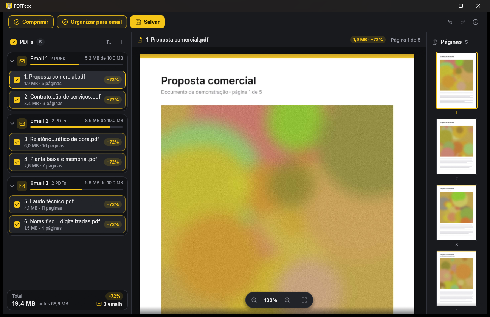
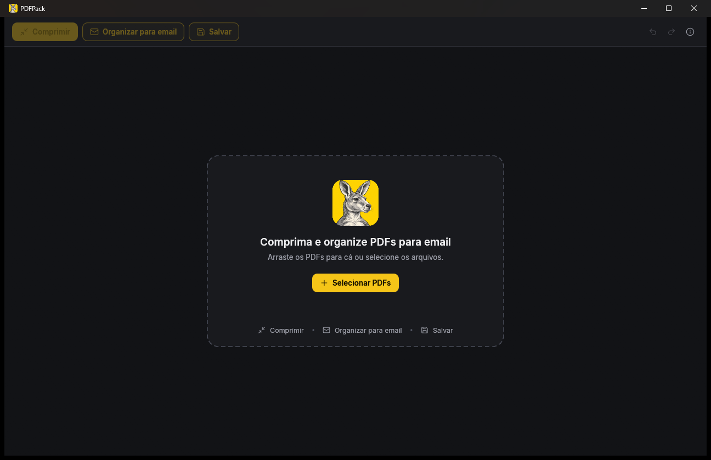
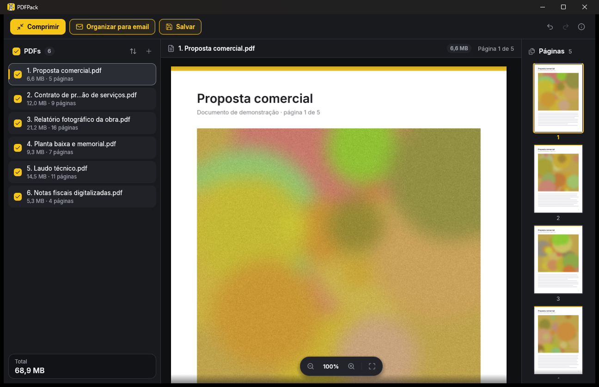
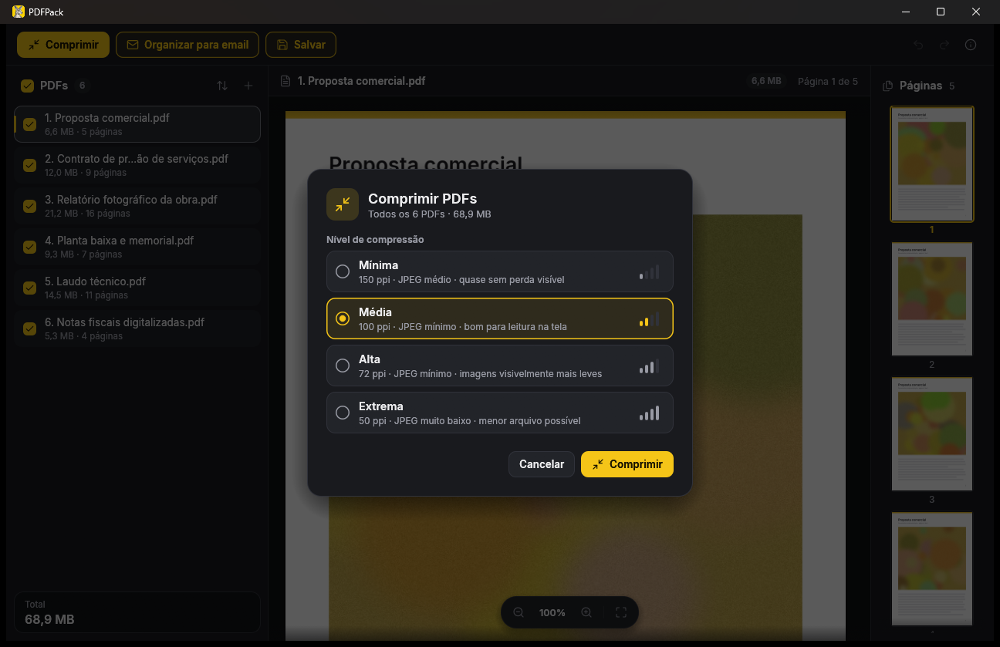
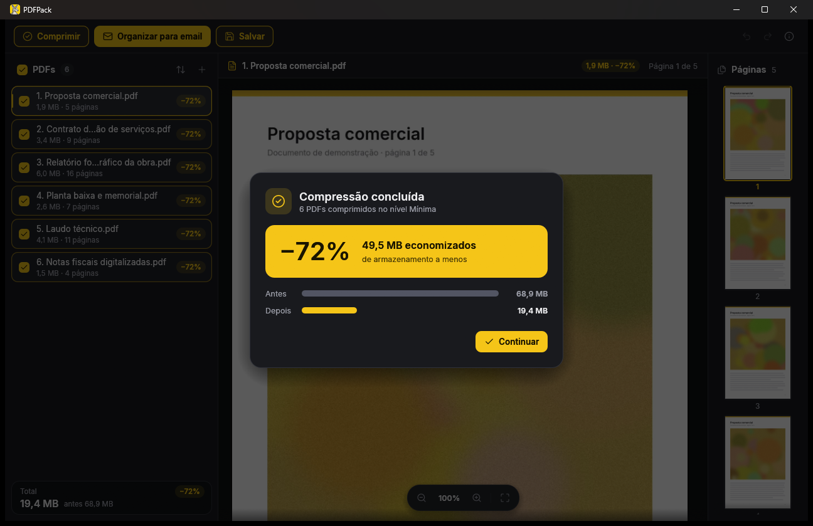
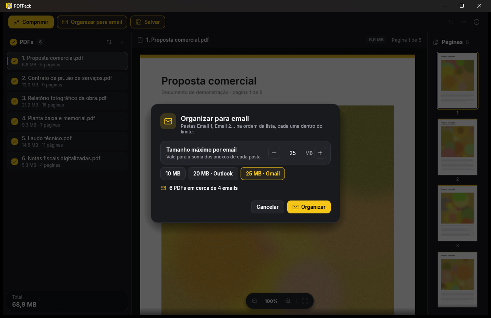
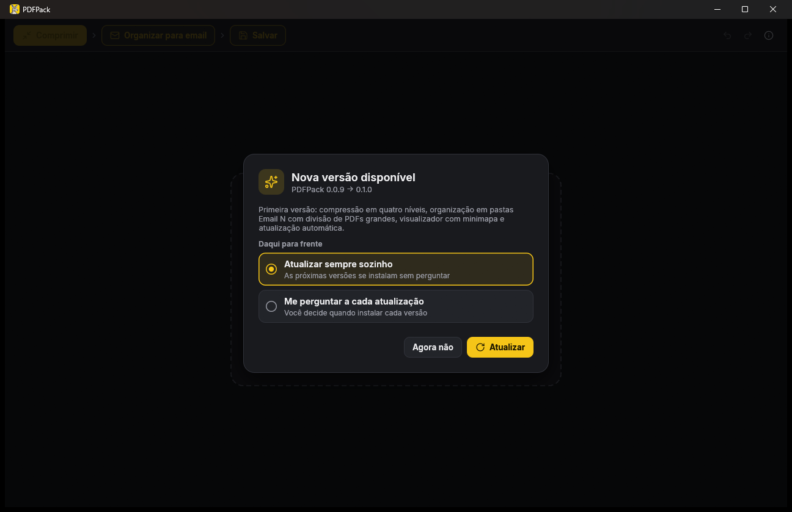

<p align="center">
  
</p>

<p align="center">
  <b>Deixa seus PDFs leves e, se você quiser, separa tudo em pastas que cabem em um email.</b><br>
  Para Windows · gratuito · funciona sem internet
</p>

<p align="center">
  <a href="https://github.com/GiovanniBot/pdfpack/releases/latest/download/pdfpack.exe"><b>⬇ Baixar o PDFPack para Windows</b></a>
</p>

<p align="center">
  
</p>

**Neste documento**

- [Para quem vai usar](#para-quem-vai-usar): o que é, como baixar e o passo a passo com fotos.
- [Para quem é técnico](#para-quem-é-técnico): como funciona por dentro, como compilar e como publicar versões.

---

# Para quem vai usar

## O problema que ele resolve

Você precisa mandar vários PDFs por email, mas eles são pesados e o email recusa anexos acima de
um certo tamanho (25 MB no Gmail, por exemplo). O PDFPack faz as duas coisas que faltam:

1. **Comprime** os PDFs, para ficarem bem mais leves.
2. **Organiza** os PDFs em pastas chamadas `Email 1`, `Email 2`, `Email 3`… Cada pasta cabe em
   um email. Depois é só criar um email para cada pasta e anexar o que está dentro dela.

Se um único PDF for maior que o limite mesmo depois de comprimido, o PDFPack o **divide em partes**
sozinho.

As duas coisas são independentes. Se você só precisa de PDFs mais leves, comprima, salve e pronto:
organizar para email é opcional.

## Como baixar e abrir

1. Clique em **[Baixar o PDFPack](https://github.com/GiovanniBot/pdfpack/releases/latest/download/pdfpack.exe)**.
2. Guarde o arquivo `pdfpack.exe` em uma pasta sua, como **Documentos** ou a **Área de Trabalho**.
3. Dê dois cliques nele. Não há instalação.

> Na primeira vez, o Windows pode mostrar o aviso azul "O Windows protegeu o computador". Isso
> acontece com programas novos que ainda não têm assinatura digital. Clique em **Mais informações**
> e depois em **Executar assim mesmo**.

## Passo a passo

### 1. Abra seus PDFs

Arraste os PDFs para a janela ou clique em **Selecionar PDFs**.

<p align="center"></p>

Os arquivos aparecem na lista da esquerda. Se os nomes começam com números (`1.`, `2.`, `3.`…),
eles já entram nessa ordem. No meio você vê o PDF selecionado; à direita, as páginas dele.

<p align="center"></p>

Você pode:

- **arrastar** um PDF na lista para mudar a ordem;
- usar o botão de setas (⇅) para ordenar por numeração, nome, tamanho ou data;
- **desmarcar** os PDFs que não quer comprimir;
- clicar em uma página à direita para ir direto a ela.

### 2. Comprima

Clique em **Comprimir** e escolha o nível. Quanto mais forte, mais leve o arquivo e menor a
qualidade das imagens. O texto continua nítido em todos os níveis.

<p align="center"></p>

| Nível | Quando usar |
| --- | --- |
| **Mínima** | Quando as fotos e imagens precisam continuar bonitas. |
| **Média** | O equilíbrio para o dia a dia: bom para ler na tela. É o nível que já vem marcado. |
| **Alta** | Quando o arquivo precisa ficar bem leve e a imagem pode perder qualidade. |
| **Extrema** | Quando o tamanho importa mais que tudo. |

No final, o PDFPack mostra quanto você economizou. Cada PDF comprimido ganha uma borda amarela e
a porcentagem que diminuiu.

<p align="center"></p>

Não gostou do resultado? Aperte **Ctrl+Z** para desfazer e tente outro nível.

### 3. Organize para email (opcional)

Pule este passo se você só queria comprimir.

Clique em **Organizar para email** e diga qual é o tamanho máximo que o seu email aceita. O
PDFPack lembra do valor que você usou da última vez.

<p align="center"></p>

Os PDFs são distribuídos em pastas, na ordem da lista, e cada pasta mostra quanto do limite está
ocupando.

<p align="center"></p>

### 4. Salve

Clique em **Salvar** (ou **Ctrl+S**) e escolha onde guardar.

- **Se você organizou para email**, o PDFPack cria ali as pastas `Email 1`, `Email 2`… com os PDFs
  dentro. Depois é só anexar o conteúdo de cada pasta em um email.
- **Se você só comprimiu**, os PDFs comprimidos são gravados direto na pasta escolhida.

**Seus arquivos originais nunca são alterados.** O PDFPack sempre grava cópias novas.

## Atualizações

O PDFPack se atualiza sem você precisar baixar nada de novo. Quando a primeira versão nova
chegar, ele pergunta como você prefere:

<p align="center"></p>

- **Atualizar sempre sozinho**: as próximas versões se instalam sem perguntar.
- **Me perguntar a cada atualização**: você decide quando instalar cada uma.

Dá para mudar de ideia depois no botão **ⓘ**, no canto superior direito. A versão nova passa a
valer na próxima vez que o programa abrir.

## Perguntas comuns

**Meus PDFs são enviados para a internet?**
Não. Tudo acontece no seu computador. A única coisa que o PDFPack busca na internet é a
informação de que existe uma versão nova do próprio programa.

**Que tamanho máximo devo usar?**
Use o limite do seu provedor de email: **25 MB** no Gmail e **20 MB** no Outlook.com. O que conta
é a conta de email, não o programa: uma conta do Gmail usada dentro do Outlook segue o limite do
Gmail. Se um email voltar por ser grande demais, diminua um pouco o valor e organize de novo.

**O PDF ficou com as imagens ruins. E agora?**
Desfaça com **Ctrl+Z** e comprima de novo em um nível mais fraco (Mínima ou Média).

**Um PDF apareceu como "parte 1 de 2". Por quê?**
Ele era maior que o limite do email, então foi dividido. As partes ficam em pastas seguidas e
mantêm a ordem das páginas.

**Atalhos do teclado**

| Atalho | O que faz |
| --- | --- |
| Ctrl+O | Abrir PDFs |
| Ctrl+S | Salvar |
| Ctrl+Z | Desfazer |
| Ctrl+Shift+Z ou Ctrl+Y | Refazer |
| Delete | Tirar da lista o PDF selecionado |

---

# Para quem é técnico

## Visão geral

O PDFPack é um aplicativo nativo em **Rust**, com interface em [egui](https://github.com/emilk/egui)
(eframe, renderizador glow). Ele reaproveita o motor de PDF do projeto de código aberto
[PDFCraft](https://github.com/storytold/pdfcraft): leitura e escrita do grafo de objetos, o
otimizador de imagens, a extração de páginas e o renderizador. Tudo o que o PDFCraft tem além
disso (edição, formulários, OCR, assinatura…) ficou de fora.

É um único executável, sem instalador, sem serviço e sem dependências em tempo de execução.

```
apps/pdfpack/        o aplicativo
  src/main.rs        estado da janela, atalhos, histórico de desfazer e refazer
  src/core.rs        níveis de compressão, compressão, divisão e distribuição em emails
  src/state.rs       documentos, tarefas em segundo plano, gravação e preferências
  src/render.rs      fila de renderização de páginas e miniaturas
  src/update.rs      atualização automática
  src/list.rs        barra superior e lista de PDFs e emails
  src/viewer.rs      visualizador e minimapa
  src/modals.rs      diálogos
  src/theme.rs       cores, fontes e botões
  src/icons.rs       ícones Lucide
  assets/            logo e ícone do executável
  screenshots/       as imagens deste README
crates/              o motor herdado do PDFCraft (cos, optimize, organize, render…)
vendor/              dependências de terceiros com correções do PDFCraft
scripts/release.ps1  publica uma versão
```

## Compressão

A compressão reamostra e recomprime as imagens do PDF, remove recursos duplicados e regrava o
arquivo inteiro com *object streams*. Texto e vetores não são tocados. Os níveis estão em
[`core.rs`](apps/pdfpack/src/core.rs):

| Nível | Imagens em cor e cinza | JPEG | Imagens monocromáticas |
| --- | --- | --- | --- |
| Mínima | 150 ppi, para as acima de 225 ppi | qualidade 60 | 300 ppi, para as acima de 450 ppi |
| Média | 100 ppi, para as acima de 100 ppi | qualidade 25 | 100 ppi, para as acima de 100 ppi |
| Alta | 72 ppi, para as acima de 72 ppi | qualidade 25 | 100 ppi, para as acima de 100 ppi |
| Extrema | 50 ppi, para as acima de 50 ppi | qualidade 12 | 72 ppi, para as acima de 72 ppi |

Em todos os níveis a reamostragem é bicúbica, as imagens monocromáticas saem em CCITT grupo 4 e
os fragmentos de imagem são unidos. O nível **Média** reproduz a configuração do otimizador do
PDFCraft com 100 ppi e JPEG na qualidade mínima.

Uma imagem que não pode ser redimensionada (por exemplo, quando a máscara de transparência não
acompanha o novo tamanho) ainda é recomprimida no tamanho original, em vez de ser pulada.

Depois de regravado, o arquivo é reaberto para conferir que continua válido. Se a compressão não
diminuir um PDF, ele fica como estava.

Medição em um livro ilustrado de 57,8 MB, em um computador de mesa comum:

| Nível | Resultado | Redução |
| --- | --- | --- |
| Mínima | 47,7 MB | 17% |
| Média | 29,6 MB | 49% |
| Alta | 18,4 MB | 68% |
| Extrema | 9,8 MB | 83% |

Cada nível levou cerca de 3 segundos. O resultado depende muito do conteúdo: PDFs feitos de fotos
e digitalizações diminuem bastante; PDFs só de texto quase não mudam.

## Organização em emails

A distribuição é sequencial: percorre a lista na ordem em que está e abre uma pasta nova quando o
próximo PDF não cabe na atual. A ordem da lista é sempre respeitada; o algoritmo não reordena
para ocupar melhor o espaço.

Um PDF maior que o limite é dividido por páginas. Para cada parte, uma busca binária acha o maior
número de páginas que cabe, gravando de verdade cada tentativa, porque o tamanho de um PDF não é
a soma dos tamanhos das páginas (fontes e imagens são compartilhadas). Uma página que sozinha
passa do limite vira uma parte só dela.

As pastas são um estado derivado da lista ordenada e do limite, o que mantém desfazer e refazer
simples: cada passo do histórico guarda a lista, e os bytes dos PDFs são compartilhados entre os
passos.

## Gravação

Salvar grava `Email N/<nome>.pdf` na pasta escolhida, ou os PDFs direto nela quando ainda não
foram organizados. Um arquivo de origem nunca é sobrescrito: se o destino for o próprio original,
a cópia sai como `<nome> (comprimido).pdf`. Partes de um PDF dividido se chamam
`<nome> (parte 1 de 3).pdf`.

## Atualização automática

Implementada em [`update.rs`](apps/pdfpack/src/update.rs), sem instalador nem serviço:

1. Ao abrir, o aplicativo consulta `releases/latest` deste repositório na API do GitHub.
2. Se a tag for mais nova que a versão compilada e a release tiver o anexo `pdfpack.exe`, ele
   baixa o anexo para `pdfpack.new`, ao lado do executável.
3. Confere o tamanho, o **SHA-256** que o GitHub publica para o anexo e o cabeçalho de
   executável. Só aceita URLs `https://github.com/`.
4. Renomeia o executável em uso para `pdfpack.old` (o Windows permite renomear um executável
   aberto) e põe o novo no lugar. Se a troca falhar, o antigo volta.
5. Na abertura seguinte, o `pdfpack.old` é apagado.

Na primeira atualização o usuário escolhe entre atualizar sempre sozinho ou ser perguntado a cada
vez. A escolha fica em `auto_update` nas preferências e pode ser mudada no menu ⓘ, que também
tem **Procurar atualizações**.

Limites conhecidos:

- O executável precisa estar em uma pasta em que o usuário possa gravar. Em `C:\Program Files`,
  sem permissão de administrador, a atualização falha com uma mensagem e o aplicativo continua
  na versão atual.
- O executável não tem assinatura de código, então o SmartScreen pode avisar no primeiro uso.
- A verificação confia no GitHub: o hash vem da mesma API que indica o download.

## Preferências

Ficam em `%APPDATA%\PDFPack\preferencias.json`:

```json
{
  "email_limit_mb": 25.0,
  "level": "Media",
  "auto_update": true
}
```

`auto_update` começa como `null` e só é definido quando o usuário responde à pergunta da
primeira atualização.

## Compilar

Precisa do [Rust](https://rustup.rs) 1.95 ou mais novo.

```
cargo build --release -p pdfpack
```

O executável sai em `target/release/pdfpack.exe`. `pdfpack.exe --version` imprime a versão.

Para rodar os testes do aplicativo:

```
cargo test -p pdfpack
```

A consulta de atualizações só acontece em compilações de release, para não interferir no
desenvolvimento.

## Publicar uma versão

1. Aumente `version` em [`apps/pdfpack/Cargo.toml`](apps/pdfpack/Cargo.toml).
2. Faça o commit.
3. Rode `scripts/release.ps1` (precisa do [GitHub CLI](https://cli.github.com/) autenticado).

O script compila, confere que o executável informa a versão certa, envia o commit, cria a tag
`vX.Y.Z` e publica a release com `pdfpack.exe` anexado. É esse anexo que os aplicativos já
instalados baixam. O texto passado em `-Notes` aparece para o usuário no diálogo de atualização.

```
scripts/release.ps1 -Notes "Corrige a divisão de PDFs com uma página só."
```

## Licença e créditos

MIT ou Apache-2.0, à sua escolha, como o PDFCraft.

- O motor de PDF é do projeto [PDFCraft](https://github.com/storytold/pdfcraft) e de seus
  contribuidores. Veja `NOTICE`, `ATTRIBUTION.md` e `licenses/`.
- Ícones [Lucide](https://lucide.dev) (ISC e MIT). Fonte [Inter](https://rsms.me/inter/) (OFL-1.1).
- O logo do canguru é do autor do PDFPack.
- As imagens deste README mostram apenas a interface do PDFPack e documentos fictícios criados
  para a demonstração.
